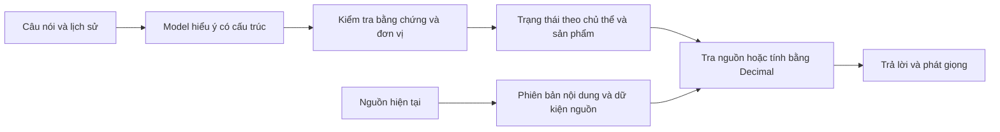

# Hiểu hội thoại và dùng dữ liệu đang có hiệu lực

Các câu nói khác nhau cùng đi qua một hợp đồng dữ liệu. Model xác định ý định,
vai trò của dữ kiện, chủ thể và trạng thái thực tế/giả định/phủ định. Model không
viết lời phê duyệt và không tự tính số tiền cho khách.

`grounded_dialogue.py` giữ câu gốc do hệ thống cung cấp. Dữ kiện chỉ được nhận
khi đoạn trích có đúng một vị trí trong lời khách và giá trị có căn cứ từ đoạn
trích đó. Cách viết số khác nhau được chuẩn hóa bằng quy tắc số và đơn vị; đơn
vị tiền hoặc thời gian còn thiếu không được đoán. Tuổi và thu nhập theo chủ thể
được tách khỏi tiền vay, tiền gửi, giá nhà và thời hạn của từng sản phẩm.

Một bộ cập nhật trạng thái xử lý sửa, rút lại và mâu thuẫn. Hai giá trị chưa
được phân giải không trở thành dữ kiện chắc chắn để tính ở lượt sau. Dữ kiện
của người khác hoặc của tài liệu không được chuyển thành dữ kiện cá nhân của
người nghe máy. Thời gian đã gửi được tách khỏi kỳ hạn đã đăng ký.

`grounded_sources.py` đọc nội dung nguồn và tạo phiên bản SHA-256. Cache gắn
với sản phẩm và nội dung, không gắn với câu hỏi hay một bộ lãi suất trong code.
Các phiên cùng đọc một phiên bản dùng chung kết quả trích. Giá trị nguồn luôn
có đoạn trích, đơn vị và tính chất như chính xác, tối thiểu, tối đa hay ước tính.
Adapter cho bảng sản phẩm xử lý trường có nhãn; model có thể đề xuất phần chưa
đọc được, và code kiểm tra lại bằng chứng. Phần thiếu hoặc mâu thuẫn vẫn thiếu
hoặc mâu thuẫn, không được điền bằng con số mặc định.

Các trường tài chính tường minh trong văn bản được tách thành đoạn có nhãn và
đọc trực tiếp, giữ đúng chủ thể, hạng thẻ và phạm vi áp dụng. Cả đường đọc trực
tiếp lẫn đề xuất của model dùng cùng bộ kiểm tra. Một giới hạn của hạng thẻ
không trở thành trần chung của sản phẩm; thời gian ưu đãi không bị bỏ đi để
biến lãi suất ưu đãi thành lãi suất chung.

`grounded_executor.py` trả thông tin công bố từ các đoạn nguồn đã chọn. Những
phép tính chỉ dùng toán hạng và bằng chứng đã kiểm tra. Lãi suất ghi “từ” không
được coi là lãi suất đã chốt của khách; phần tính theo một tỷ lệ riêng không
được gọi là toàn bộ hạn mức nếu còn thiếu trần khác. Đối chiếu điều kiện không
phải quyết định phê duyệt. Hồ sơ riêng, phí đã thu hay số dư cần nguồn hồ sơ
được xác thực riêng.

Mất trường cộng lãi online không có nghĩa mức cộng bằng không. Phép tính online
cần bằng chứng hiện tại cho mức cộng, kể cả khi mức đó bằng không. Hạng thẻ được
nêu trong câu hỏi chính sách chỉ là phương án đang hỏi, không xác nhận người
gọi sở hữu thẻ. Luồng mới tự xử lý câu hỏi làm rõ; luồng dẫn dắt cũ không nối
thêm câu hỏi bán hàng dựa trên một sổ dữ kiện khác.

`grounded_runtime.py` chụp một phiên bản nguồn cho lượt nói và kiểm tra lại
trước khi ghi trạng thái. Nguồn đổi giữa lượt thì thử lại một lần với bản mới;
nguồn tiếp tục đổi thì hỏi lại, không phát số từ bản cũ. Khi đổi tổ chức hoặc
phạm vi nguồn, tài liệu demo chung không được tự áp sang tổ chức đó.

Model dùng Ollama structured outputs với JSON schema. Hợp lệ về cấu trúc chưa
chứng minh model đã hiểu đúng câu nói; vì vậy cần cả kiểm thử hợp đồng, biến
đổi dữ liệu và hội thoại với model thật. [Tài liệu Ollama](https://docs.ollama.com/capabilities/structured-outputs).

Các bộ dữ kiện cố định trong test là fixture có phiên bản, không phải thông số
sản phẩm chạy thật. Các bản ghi thử, câu trả lời và audio được giữ riêng trong
`data/bo_thu`; không đưa chúng lên Git công khai.
